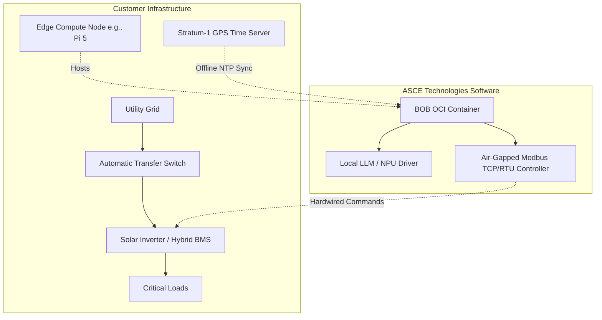

# BOB: Reference Hardware Profile (Customer-Supplied Edge Compute)

## Overview

**ASCE Technologies is a pure software company.** We do not manufacture hardware, we do not sell physical devices, and we do not hold inventory. 

Our product, **BOB (Building Offline Backbone)**, is a specialized OCI container / Red Hat Operator. It is designed to be deployed onto off-the-shelf, customer-owned edge hardware to provide autonomous, zero-cloud load shedding and microgrid survival intelligence.

This document outlines the **Reference Hardware Profile** that we certify our software to run against. Customers (utilities or commercial property managers) procure and install this hardware themselves, and we deploy the BOB software payload onto it.

## Target Deployment Environments

BOB is compiled to run on standard edge-compute architectures, primarily ARM64. The customer must provide a compute node that meets the following minimum specifications to handle the local LLM inference and Modbus actuation:

### Minimum Edge Node Specifications (e.g., Raspberry Pi 5 Class)
*   **CPU:** Quad-core ARM64 (e.g., Cortex-A76 or equivalent)
*   **RAM:** 8GB minimum (strictly required for INT4 LLM quantization)
*   **AI Accelerator (NPU):** Hailo-8 (26 TOPS) or NVIDIA Jetson Orin Nano (40 TOPS)
*   **Storage:** 64GB High-Endurance Solid State Storage
*   **I/O:** Ethernet (for Modbus TCP) or USB/RS485 adapter (for Modbus RTU)

### Enterprise/Industrial Target Hardware
Tier-1 utility customers may deploy BOB onto ruggedized industrial gateways they already use in the field, provided they have sufficient NPU capability:
*   **Dell Edge Gateways** (with AI accelerator cards)
*   **Cisco Industrial Routers** (IOx Edge Compute framework)
*   **OnLogic Rugged Edge PCs**

## System Architecture (Software View)

The following diagram illustrates how the BOB OCI Container interfaces with the customer's physical infrastructure:

## Physical Actuation

BOB's software does not physically switch power. The OCI container utilizes Modbus TCP/RTU to send state-change commands to customer-supplied DIN-rail contactors or smart inverters. This establishes an impenetrable cybersecurity air-gap by removing the need for cloud-based Wi-Fi/cellular cards on the inverter.